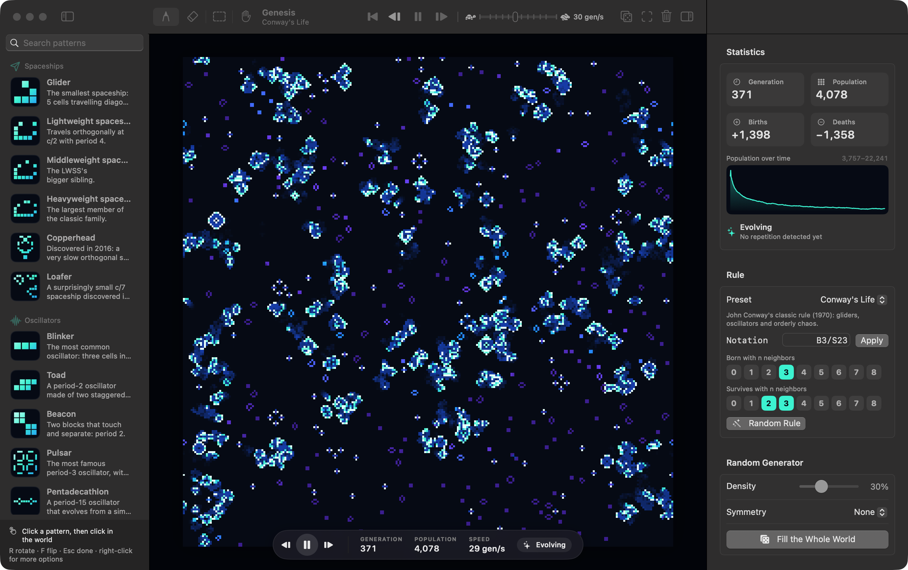
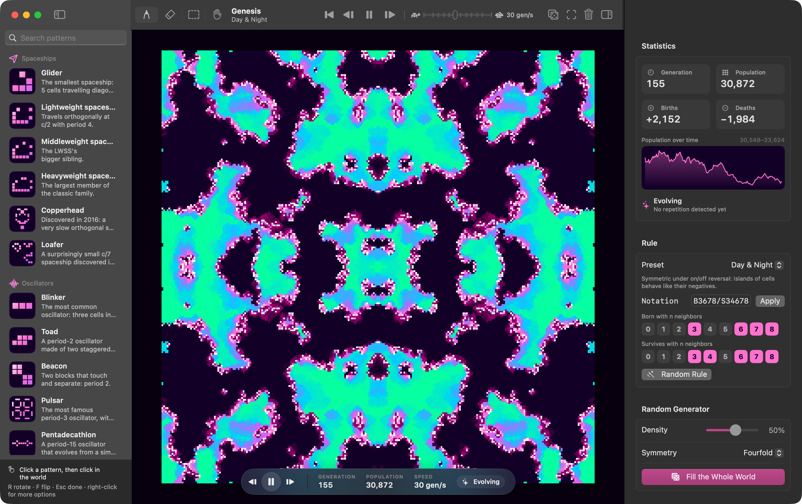
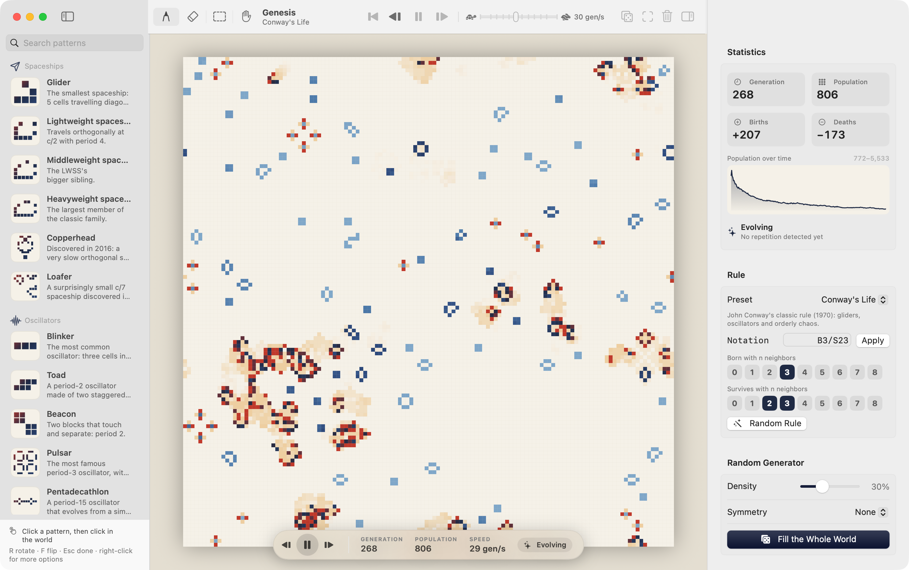
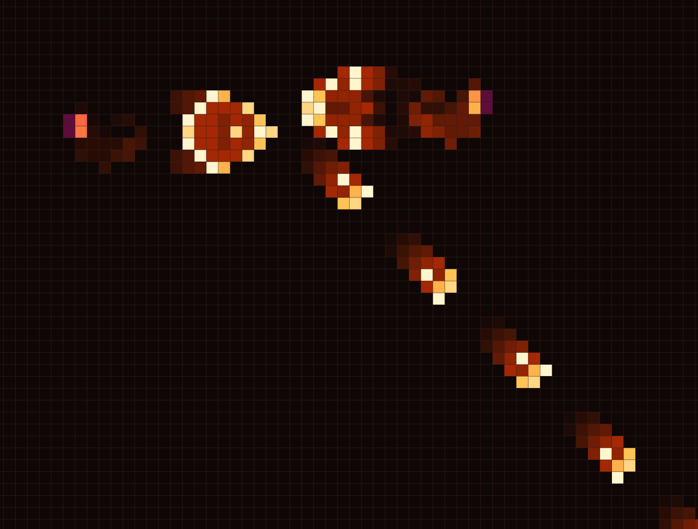

<p align="center">
  
</p>

<h1 align="center">Genesis</h1>
<p align="center"><b>Conway's Game of Life, as a proper Mac app</b><br>
Swift, SwiftUI and Core Animation. No dependencies.</p>

<p align="center"><a href="https://github.com/El3k0n/gameoflife/releases/latest"><b>Download for macOS 14 or later</b></a></p>

<p align="center"></p>

---

A grid of cells, two rules. A dead cell with exactly three live neighbours comes alive; a live cell with two or three stays alive; everything else dies. John Conway came up with it in 1970 and people are still finding new things in it: patterns that crawl across the grid, guns that fire them, a handful of cells that churns for a thousand generations before it settles down.

It has been written in every language there is. This is the version I wanted on my Mac: fast enough to run four million cells, able to go back in time, and nice enough to leave running on a second screen.

## Features

**Simulation**
- A multi-core engine for grids from 128 × 128 to 2048 × 2048 cells, at 1 to "as fast as it goes" generations per second.
- Time travel: step back through hundreds of generations (← or ⌘Z), drawing and erasing included. Reset jumps back to where you pressed Play.
- Cycle detection: Genesis notices when the world freezes or starts repeating, tells you the period and can pause by itself.
- A wrapping world (torus) or one with dead edges.

**Rules**
- 19 life-like rules in B/S notation: Conway's Life, HighLife, Day & Night, Seeds, Maze, Replicator, Diamoeba, Morley and more.
- A visual editor: click the neighbour counts 0–8 that give birth or survival and watch the world change under the new rule. Or type any rule (`B36/S23`, `23/3`), or roll a random one.
- Random soups with any density and with mirror, fourfold or rotational symmetry.

<table>
  <tr>
    <td></td>
    <td></td>
  </tr>
</table>

**Pattern library**
- Spaceships (glider, LWSS/MWSS/HWSS, Copperhead, Loafer), oscillators (pulsar, pentadecathlon, Kok's galaxy, queen bee shuttle), still lifes, the Gosper glider gun, methuselahs (R-pentomino, Acorn, Diehard, Rabbits) and patterns that grow forever, plus a few for other rules.
- The pattern follows the pointer before you place it: R rotates, F flips, Esc stops.

<p align="center"><br>
<sub>The Gosper glider gun, one glider every 30 generations. Brighter cells are younger.</sub></p>

**Drawing and editing**
- Draw, Erase, Select and Pan tools (keys 1–4).
- Copy, cut and paste selections as RLE, the format Golly and LifeWiki use. Clear a selection, keep only the selection, fill it with a soup.

**Looks**
- Seven palettes: Bioluminescence, Ember, Aurora, Synthwave, Terminal, Ink & Paper, Monochrome.
- Cells coloured by age, fading trails where cells died, optional glow, and grid lines that show up as you zoom in.
- Pinch, scroll or use the keyboard to zoom; pan with two fingers, ⌥-drag or the middle button.
- A population chart and live counts of births, deaths and actual speed.

**Files**
- Open `.rle` and `.cells` files, or drop them on the window. Save the world or a selection as RLE.
- Export a PNG at up to 4096 pixels.

## How it's built

**Column sums.** Cells live in plain byte buffers, one byte each. For every row the engine first adds up each column of three cells; a cell's neighbour count is then three neighbouring column sums minus the cell itself, about half the work of visiting all eight neighbours. The count is looked up in an 18-entry table (birth and survival for 0–8 neighbours), so any rule runs as fast as Conway's. Each generation is split into bands of rows that run in parallel on every core with `DispatchQueue.concurrentPerform`.

**One pixel per cell.** The renderer writes the world into a bitmap, one pixel per cell, with colours from the palette's lookup tables by age and trail. A Core Animation layer scales it on the GPU with nearest-neighbour filtering, so zooming stays smooth on a 2048 × 2048 grid, and the bitmap is only rebuilt when the world changes.

**History in bits.** Every step back is a snapshot packed at one bit per cell: 512 KB for the largest grid, 32 KB for the default one. They sit in a ring buffer capped at 160 MB, which is 320 steps on the largest grid and 3,000 on the default. The same packed state is hashed to detect cycles: when a hash comes back, the gap between the two generations is the period.

**Checked against known results.** `swift test` runs the engine against facts about Life: the blinker has period 2, Diehard disappears after 130 generations, the R-pentomino settles at 116 cells in generation 1103, a glider comes back to where it started after going round the torus. RLE parsing and writing are tested on every pattern in the library.

**Screenshots by the app itself.** The images in this README come from [scripts/screenshots.sh](scripts/screenshots.sh), which launches the app with `--snapshot` options: set up the world, run it, save the window, quit. The animation is 30 consecutive generations, one full period of the gun, so it loops without a seam.

## Install

Download `Genesis.zip` from the [latest release](https://github.com/El3k0n/gameoflife/releases/latest), unzip it and move Genesis to Applications.

The app is not notarized (that takes a paid Apple developer account), so macOS blocks it the first time. Try to open it once, then go to System Settings → Privacy & Security and click **Open Anyway**. Or remove the quarantine flag from the terminal:

```sh
xattr -dr com.apple.quarantine /Applications/Genesis.app
```

## Build from source

You need macOS 14 and Xcode 15 or later (the Command Line Tools are enough for a native build).

```sh
git clone https://github.com/El3k0n/gameoflife.git
cd gameoflife
./scripts/build-app.sh
open build/Genesis.app
```

`./scripts/build-app.sh install` also copies the app to `/Applications`; `./scripts/build-app.sh universal` builds for Apple silicon and Intel (this one needs full Xcode). You can also open `Package.swift` in Xcode and press ⌘R. Run the tests with `swift test`.

GitHub Actions runs the tests on every push, builds the universal app, checks the bundle and launches it. Tagged versions are published as releases.

## Shortcuts

| Key | Action |
|---|---|
| Space | Play / pause |
| → / ← | One generation forward / back |
| ⌘Z | Undo (back to the previous state) |
| ⇧⌘R | Reset to the starting state |
| [ / ] | Slower / faster |
| 1 2 3 4 | Draw · Erase · Select · Pan |
| R | Random soup (or rotate the pattern being placed) |
| F | Flip the pattern being placed / zoom to content |
| ⌘C ⌘X ⌘V | Copy, cut, paste RLE |
| ⌘0 / ⌘9 | Zoom to content / show the whole world |
| ⌘? | Help |

## Code layout

```
Sources/Genesis/
├── App/        GenesisApp.swift (scene, app delegate, opening files), Snapshot.swift (--snapshot)
├── Engine/     Rule, Pattern (RLE and plaintext), LifeEngine, PatternLibrary
├── Model/      LifeModel (state and commands), Palette
├── Canvas/     LifeCanvasView (NSView on Core Animation layers), CellRenderer
└── UI/         ContentView, sidebar, inspector, menu commands, help
```

## License

Released under the [MIT License](LICENSE).
