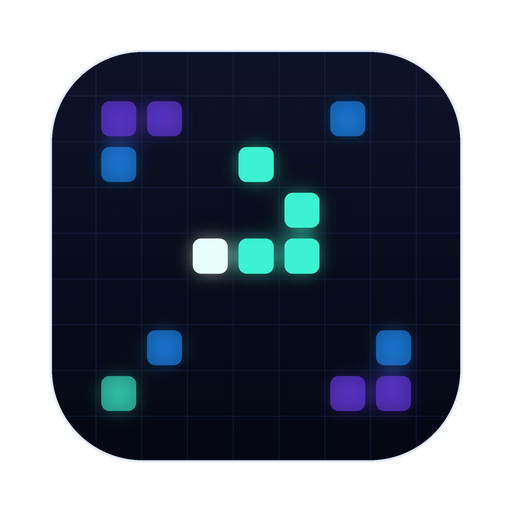
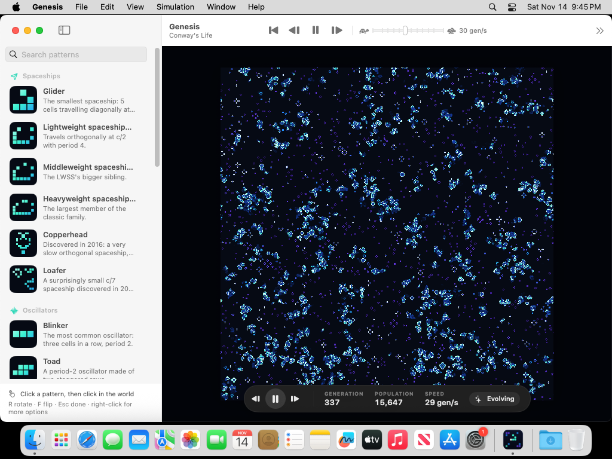

<p align="center">
  
</p>

<h1 align="center">Genesis</h1>
<p align="center"><b>Conway's Game of Life as a native macOS app</b><br>
Swift · SwiftUI · AppKit · Core Animation, with no third-party dependencies</p>

<p align="center"></p>

---

## Features

**Simulation**
- Fast multi-core engine: grids from 128² up to 2048² (4 million cells).
- Speeds from 1 generation per second up to "Max", plus single-stepping.
- **Time travel**: step back through hundreds of generations (← or ⌘Z), even after drawing or erasing.
- **Reset to start**: return to the state you had when you pressed Play.
- **Cycle detection**: Genesis notices when the world becomes static or enters a cycle, reports the period, and can pause automatically.
- Toroidal world (wrapping edges) or bounded world.

**Rules**
- 19 well-known rules in B/S notation: Conway, HighLife, Day & Night, Seeds, Maze, Replicator, Diamoeba, Morley…
- **Visual rule editor**: tap the numbers 0–8 to decide when a cell is born or survives, and watch the world change in real time.
- Custom rules (`B36/S23`, `23/3`…) and a **random rule** button for exploring.

**Pattern library** (every pattern verified by simulation)
- Spaceships (glider, LWSS/MWSS/HWSS, Copperhead, Loafer), oscillators (pulsar, pentadecathlon, Kok's galaxy, queen bee shuttle…), still lifes, the Gosper glider gun, methuselahs (R-pentomino, Acorn, Diehard, Rabbits…), infinitely growing patterns, and patterns for other rules (HighLife replicator, Seeds, Gnarl).
- A preview follows the pointer; **R** rotates, **F** flips, click to place, Esc to finish.

**Drawing and editing**
- Draw, Erase, Select and Pan tools (keys 1–4).
- Copy, cut and paste selections in **RLE** format (compatible with Golly and LifeWiki); clear, isolate and randomize selections.
- Random soups with adjustable density and **symmetry** (mirror, fourfold, rotational).

**Appearance**
- 7 palettes (Bioluminescence, Ember, Aurora, Synthwave, Terminal, Ink & Paper, Monochrome).
- Cells colored by **age**, glowing **trails** left by dead cells, an optional glow, and a grid that fades in as you zoom.
- Smooth zooming with trackpad pinch, scroll wheel or keyboard; pan with two fingers, ⌥-drag or the middle mouse button.
- Population chart and live statistics (births, deaths, actual speed).

**Files**
- Open or drag `.rle` and `.cells` files onto the window; save patterns or selections as RLE.
- Export high-resolution PNG images.

## Requirements

- macOS 14 Sonoma or later (Apple silicon or Intel).
- To build: Xcode 15+ or the Command Line Tools with Swift 5.9+ (`xcode-select --install`).

## Build and run

```bash
git clone https://github.com/El3k0n/gameoflife.git
```

```bash
cd gameoflife
```

```bash
./scripts/build-app.sh
```

```bash
open build/Genesis.app
```

Variants:

```bash
./scripts/build-app.sh install
```

copies the app to `/Applications`, while

```bash
./scripts/build-app.sh universal
```

builds a universal binary (requires full Xcode). You can also open `Package.swift` in Xcode and press ⌘R.

Run the engine tests with:

```bash
swift test
```

Every push builds the app on macOS with GitHub Actions; the `Genesis-macOS` zip can be downloaded from the run's artifacts. The app is ad-hoc signed, so macOS may block it the first time: right-click it and choose **Open**, or run `xattr -dr com.apple.quarantine Genesis.app`.

## Main shortcuts

| Key | Action |
|---|---|
| Space | Play / pause |
| → / ← | Step forward / back one generation |
| ⌘Z | Undo (go back to the previous state) |
| ⇧⌘R | Reset to the starting state |
| [ / ] | Slower / faster |
| 1 2 3 4 | Draw · Erase · Select · Pan |
| R | Random soup (or rotate the pattern being placed) |
| F | Flip the pattern being placed / zoom to content |
| ⌘C ⌘X ⌘V | Copy, cut, paste RLE |
| ⌘0 / ⌘9 | Zoom to content / show the whole world |
| ⌘? | Help |

## Code layout

```
Sources/Genesis/
├── App/        GenesisApp.swift: scene, app delegate, file opening
├── Engine/     Rule, Pattern (RLE and plaintext parser/writer), LifeEngine, PatternLibrary
├── Model/      LifeModel (observable state and commands), Palette
├── Canvas/     LifeCanvasView (NSView backed by Core Animation layers), CellRenderer
└── UI/         ContentView, sidebar, inspector, menu commands, help
```

The engine keeps cells in contiguous buffers and computes each generation in parallel over bands of rows, summing neighbors column by column. The renderer turns the state into a bitmap (one pixel per cell) that Core Animation scales on the GPU with nearest-neighbor filtering. History snapshots are bit-packed (1 bit per cell), and the same packed form provides the hash used to detect cycles.

## License

Released under the [MIT License](LICENSE).
